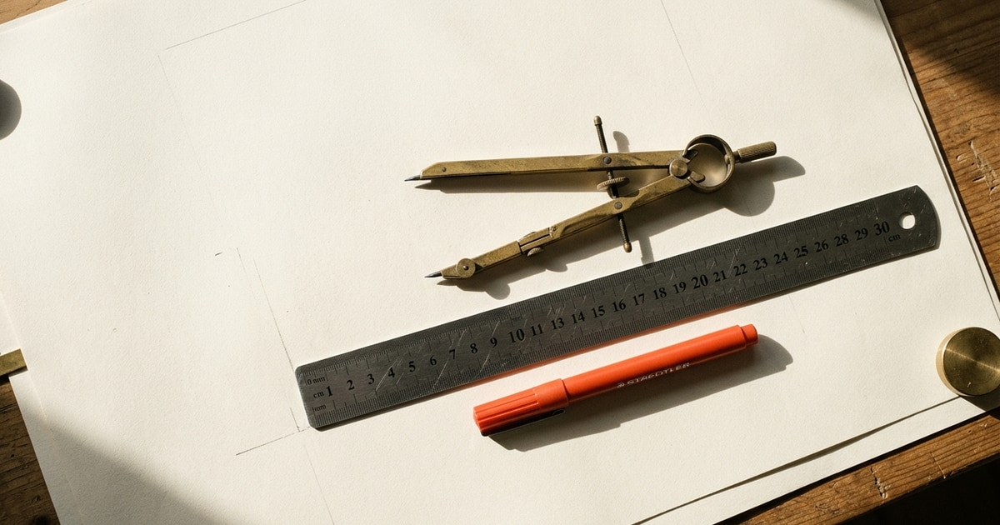
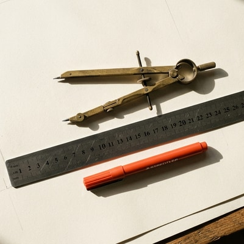
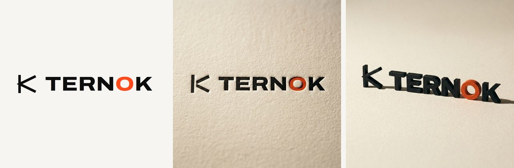

<p align="center">
  
</p>

<h1 align="center">nano-banana-mcp</h1>

<p align="center">
  <strong>Free AI image generation for Claude and any MCP client.<br>
  No API key. No billing account. No per-image cost. Just the Google account you already have.</strong>
</p>

<p align="center">
  
  
  <a href="LICENSE"></a>
  
  <a href="README.es.md"></a>
</p>

<p align="center"><sub>English · <a href="README.es.md">Leer en español</a></sub></p>

---

```
generate_image(prompt: "an orange fox on a white background", size: "1200x630")
-> images/an-orange-fox-on-a-white-background.jpg   1200x630   0 credits
```

> **Every image in this README was generated by this server.** The banner above, the crops below, and the
> logo renders further down. Nothing was touched up by hand.

---

## Why this one is different

Every other image MCP server bills you. You register for an API key, attach a credit card, and pay per image —
a few cents each, which quietly becomes real money once a model is iterating on a design and throwing away nine
attempts out of ten.

This one doesn't, because it isn't calling a paid API at all. It drives **Nano Banana**, the image model inside
[Google Flow](https://flow.google.com), through the web app you already have access to. Flow charges
credits for video. **Images cost zero.**

|                       | API-based image MCPs           | nano-banana-mcp                     |
| --------------------- | ------------------------------ | ----------------------------------- |
| API key               | Required                       | **None**                            |
| Billing account       | Required                       | **None**                            |
| Cost per image        | Cents each, and it adds up     | **$0.00**                           |
| Setup                 | Register, key, billing, secret | Sign into Google in a Chrome window |
| Exact pixel sizes     | Rarely                         | Yes                                 |
| Reference images      | Sometimes                      | Yes                                 |

The trade-off is honest and worth stating: it needs a **real Chrome window that you are signed into**, so it can't
run headless or in CI. That's the price of not having a bill.

## What it solves

Flow generates in five fixed aspect ratios: 16:9, 4:3, 1:1, 3:4 and 9:16. Real design work almost never lands on one
of them — an Open Graph card is 1200×630, a repo banner is 1456×180, an avatar is 400×400.

This server generates at the closest native ratio and crops to the exact size, using saliency detection so the crop
doesn't decapitate your subject. Ask for `1200x630`, get a 1200×630 file.

> **What "exact size" does and doesn't mean.** The model is not generating at your dimensions — Flow always returns
> its own native resolution, around 1 megapixel (1376×768 for 16:9, 1024×1024 for 1:1). The exact size is produced
> here, locally, by cropping and scaling that result. The file you get really is 1200×630; the pixels in it came from
> a 1376×768 render.
>
> That's a genuine convenience when you're going **down** from native, which covers most web work. Going **up** it
> will still hand you the file you asked for — request 3000×3000 and you get 3000×3000 — but those extra pixels are
> interpolated, not generated. There is no more detail in them. The server prints a warning when this happens; if you
> need real resolution beyond native, upscale deliberately with a tool built for it.

**One generation, three sizes.** Same source image, cropped three ways — note how the crop follows the subject
instead of blindly taking the centre:

| `1200x630` — Open Graph | `400x400` — avatar |
| --- | --- |
|  |  |

`1456x180` — repo banner


## Reference images

Give it an image and the prompt stops describing what to *create* and starts describing what to *change*. Feed it a
flat logo and ask for it letterpressed into cotton paper, or cast as a matte signage object:



<sub>Left: the source vector, handed in as a reference. Centre and right: two generations from it, four variants each,
0 credits, about a minute per batch.</sub>

```jsonc
generate_image({
  prompt: "this logo letterpressed into thick warm off-white cotton paper, raking side light",
  reference_images: ["assets/logo.png"],
  count: 4
})

// iterating on the same reference? don't re-upload it
generate_image({
  prompt: "same, but with a deeper impression and visible paper tooth",
  reference_library_names: ["logo.png"],
  count: 4
})
```

Flow doesn't take a file straight into the composer: it uploads to the project library first, and you pick it from
there. Both steps are handled for you, including the confirm click that actually attaches it. Any reference left over
from a previous turn is cleared first — a forgotten one silently changes the image, and the result gets blamed on the
prompt.

## How it works

Flow has no public API. Its internal generation call is signed with a reCAPTCHA Enterprise token minted by the page's
own JavaScript, so **it cannot be replayed from outside the browser** — and this project does not try to. That single
constraint shapes the whole design.

So it does what a person would do: type into the composer and press Enter. What's different is how it reads the result.

**It intercepts the page's own network response** instead of watching the library for something new to show up. That
response already carries the media id, the true dimensions and a signed URL, so there's no polling, no guessing which
thumbnail is yours, and no ambiguity when several generations are in flight. The only fragile part left is typing the
prompt.

**One request, four responses.** Ask for four variants and Flow doesn't return an array — it sends four separate HTTP
responses, staggered by a couple of seconds. Waiting for "the next response" quietly drops three of them and looks
exactly like an account limit. The collector listens to the whole stream and closes on whichever comes first: all
expected images, a 20-second silence, or the hard timeout. It never discards what already arrived.

**UI anchors are Material Symbols ligature names** (`crop_16_9`, `image`, `add_2`) and numeric labels (`16:9`, `x4`).
Those are identifiers, not translatable text, so it behaves the same whether the interface is in English, Spanish or
Japanese.

**The cost gate closes before sending.** The server reads the cost *Flow itself* computes in its settings panel and
aborts if it exceeds `FLOW_MAX_COST`, which defaults to 0. The refusal happens while refusing is still free. If the
number can't be read, it doesn't send either — it won't guess.

## Requirements

- Node.js 20 or newer
- Google Chrome
- A Google account with access to Flow

That's the whole list. No API key, no cloud project, no billing account, no secret to rotate.

## Install

```bash
git clone https://github.com/frannkurt/nano-banana-mcp.git
cd nano-banana-mcp
npm install
npm run build
```

## Setup

### 1. Let the server reach Chrome

**Recommended — your everyday Chrome (version 144 or newer).** No second browser, your own session, extensions and
tabs:

1. Open `chrome://inspect/#remote-debugging` and tick **"Allow remote debugging for this browser instance"**. Below
   it Chrome should show the server running at `127.0.0.1:9222`.
2. The first time the server attaches, Chrome asks whether to allow it. Accept. The server keeps that connection for
   the whole session, so it doesn't ask again on every image.

The server finds it on its own: Chrome writes the port to `DevToolsActivePort` inside its user-data folder, and the
server reads it there. Leave `FLOW_CDP_URL` unset for this.

**Alternative — a separate Chrome with its own profile.** Chrome won't open `--remote-debugging-port` on your
everyday profile, which is why this needs a profile of its own (it will look like a fresh Chrome, without your
extensions). If nothing is found through the option above, the server falls back to port 9222 on its own. The easiest
way is the bundled launcher (persistent, dedicated profile so you sign in only once):

```bash
npm run chrome
```

It opens `flow.google.com` in a dedicated profile (`<userData>/nano-banana-flow-profile`) with the debug port on,
without touching your everyday Chrome. Sign in once; the session persists for next time.

Or do it by hand, with a profile separate from your everyday one.

**Windows**

```bash
"C:\Program Files\Google\Chrome\Application\chrome.exe" --remote-debugging-port=9222 --user-data-dir="%USERPROFILE%\.nano-banana-mcp\chrome" https://flow.google.com
```

**macOS**

```bash
"/Applications/Google Chrome.app/Contents/MacOS/Google Chrome" --remote-debugging-port=9222 --user-data-dir="$HOME/.nano-banana-mcp/chrome" https://flow.google.com
```

**Linux**

```bash
google-chrome --remote-debugging-port=9222 --user-data-dir="$HOME/.nano-banana-mcp/chrome" https://flow.google.com
```

### 2. Sign in and open a project

In that Chrome, sign in with your Google account and open a Flow project. The URL must end up at
`flow.google.com/project/<id>`.

Without an open project there is no composer, and without a composer nothing can be generated. The server remembers
the last project it worked in (`~/.nano-banana-mcp/state.json`): if Flow is open on its home page, or not open at
all, it takes a single tab back to that project.

### 3. Register the server

In Claude Code:

```bash
claude mcp add nano-banana --env FLOW_OUTPUT_DIR=./images -- node /path/to/nano-banana-mcp/dist/index.js
```

Add `--env FLOW_CDP_URL=http://127.0.0.1:9222` only if you want to force a specific Chrome instead of the automatic
choice.

Or by hand, in your MCP client's config:

```json
{
  "mcpServers": {
    "nano-banana": {
      "command": "node",
      "args": ["/path/to/nano-banana-mcp/dist/index.js"],
      "env": {
        "FLOW_OUTPUT_DIR": "./images",
        "FLOW_MAX_COST": "0"
      }
    }
  }
}
```

### 4. Check it

```bash
node scripts/doctor.mjs
```

That checks the browser, session, project, composer and balance in order, and stops at the first thing that's
wrong with instructions for fixing it. Once it's clean, try a real generation:

```bash
node scripts/smoke.mjs "an orange fox on a white background" 1200x630
```

## Tools

### `flow_status`

Connection state: session, account, open project, credit balance. Start here when something fails.

### `generate_image`

| Parameter                 | Type                            | Default            | What it does                                                  |
| ------------------------- | ------------------------------- | ------------------ | ------------------------------------------------------------- |
| `prompt`                  | string                          | —                  | Image description, in any language                            |
| `size`                    | string                          | native             | Exact output size, `"WIDTHxHEIGHT"`, e.g. `"1200x630"`         |
| `aspect`                  | `16:9` `4:3` `1:1` `3:4` `9:16` | derived from `size` | Native ratio to generate at                                   |
| `count`                   | 1–4                             | 1                  | How many variants                                              |
| `reference_images`        | string[]                        | —                  | Local paths to use as references; uploaded and attached for you |
| `reference_library_names` | string[]                        | —                  | Files already in the project library, attached without re-uploading |
| `out_dir`                 | string                          | `FLOW_OUTPUT_DIR`  | Destination folder                                             |
| `basename`                | string                          | derived from prompt | Base filename                                                  |
| `format`                  | `jpg` `png` `webp`              | `jpg`              | Output format                                                  |
| `fit`                     | `cover` `contain`               | `cover`            | `cover` crops to fill, `contain` pads the edges                |
| `background`              | CSS color                       | `#ffffff`          | Padding color when `fit` is `contain`                          |
| `upscale`                 | `2k` `4k`                       | —                  | Ask Flow's own upscaler for real detail beyond native (see below) |

Returns the saved paths, each media id, and a thumbnail of every result — so the model can see what came out and
decide whether it's worth another try.

### `generate_batch`

Generates several **different** prompts in one call, **queued in the same Flow tab**: up to 8 jobs, each with its
own optional `size`, `aspect`, `basename`, `reference_images` and `reference_library_names`. Shared `out_dir`,
`format`, `fit`, `background` and `upscale`.

Flow accepts a new prompt while the previous ones are still generating, so the tool sends them one after another
without waiting, and collects everything at the end. No extra tabs are opened. Three prompts land in about 40 seconds.

One failed job doesn't sink the rest: you get the saved files that worked and a per-job error for the ones that didn't.

### `list_library`

Lists the images in the project library, newest first: uploads (with the exact filename `reference_library_names`
expects) and generated images (with their prompt and media id). Read via the project API — no UI is touched. Filter
with `only`: `uploaded`, `generated` or `all`.

### `download_image`

Fetches an existing image by media id, with optional cropping (`size`, `fit`, `background`). Useful for recovering
something generated earlier, or pulling several sizes out of the same original. Accepts `upscale` too.

### `upscale_image`

Upscales an image that already exists in the open project, by media id, with Flow's own upscaler, and saves it
(`out_file`, optional `size`/`fit`/`background`). `target` is `2k` (default) or `4k`.

### `generate_video`

Generates a video with Veo (text to video, `16:9` or `9:16`) and saves it as `.mp4`. **Video costs credits**, so it
only runs when `FLOW_MAX_COST` is above the cost Flow quotes; otherwise it refuses before sending anything. The
result is downloaded at its original 720p (Flow's 1080p and 4K are upscales and are never chosen). Videos take a few
minutes.

## Upscaling

Nano Banana delivers 1024x1024 in square and 1376x768 in landscape, and that is where real detail ends: a larger
`size` on its own only interpolates. Flow ships its own upscaler that reconstructs the image at 2K or 4K, and it is
the only thing that adds detail. Pass `upscale: "2k"` to `generate_image` or `download_image`, or call
`upscale_image` on a media id.

| Native     | 2K        |
| ---------- | --------- |
| 1376x768   | 2752x1536 |
| 1200x896   | 2400x1792 |
| 1024x1024  | 2048x2048 |

2K is free and takes about 10 s per image. 4K is offered only on paid plans; on a free account the menu entry is
disabled and the tool says so instead of trying. Like generation, this goes through the interface (the upscale RPC
is signed with a single-use reCAPTCHA token): the tool right-clicks the tile, picks Download → 2K and takes the
result from the download the page itself starts. That means the image must belong to the project open in the Flow
tab, and upscales run one at a time.

## Configuration

| Variable                   | Default                  | What it does                                     |
| -------------------------- | ------------------------ | ------------------------------------------------ |
| `FLOW_CDP_URL`             | automatic                | Force a Chrome debugging endpoint (`http://…` or `ws://…`). Unset: your everyday Chrome if remote debugging is allowed, else `http://127.0.0.1:9222` |
| `FLOW_CHROME_USER_DATA`    | Chrome's default folder  | Where to look for `DevToolsActivePort`, if your Chrome uses a non-default user-data folder |
| `FLOW_OUTPUT_DIR`          | `~/nano-banana-images`   | Where images are saved                           |
| `FLOW_MAX_COST`            | `0`                      | Credit ceiling per generation                    |
| `FLOW_GENERATE_TIMEOUT_MS` | `180000`                 | How long to wait for Flow to answer              |
| `FLOW_LANG`                | system locale, else `en` | Language of this server's messages: `en` or `es` |

## Languages

Two different languages meet in this project, and it's worth not confusing them.

**Flow's interface language** is whatever your Google account is set to, and this server never depends on it. It
anchors on Material Symbols ligature names (`crop_16_9`, `add_2`, `image`) and numeric labels (`16:9`, `x4`) — those
are identifiers, not copy, so they read the same in every locale. It never matches translatable text like "Add to
prompt". Tested against a Spanish interface; the anchors are language-independent by construction.

The one place that used to depend on it was reading the cost. That's now taken from the panel's structure — the leaf
`<a>` element holding the number — instead of matching the word next to it. It matters because the cost gate refuses
to send when it can't read the number, so a German user seeing "0 Punkte" would have been blocked from generating
anything at all. Safe, but useless.

**This server's own messages** — errors, warnings, status, and the MCP tool descriptions your model reads — come in
English and Spanish. It picks from `FLOW_LANG`, falling back to your system locale, defaulting to English.

```bash
FLOW_LANG=es node dist/index.js
```

Code comments stay in Spanish. That's a choice about how this codebase is written, not something a user ever sees.

## Generating several at once: one tab, queued

The server works in **a single Flow tab** and never opens extra ones. It doesn't need to: the composer frees up as
soon as a prompt is sent, and Flow keeps generating it while you send the next one.

Which image belongs to which prompt: Flow draws each submission **above** the previous one, and the images take their
submission's place even if they finish in a different order. So, in screen order, the last prompt's images come
first, and the queue hands them out from the end. Reference images are uploaded **before** the queue starts, because
an uploaded image shows up in the grid just like a generated one.

The `generate_batch` tool does this for you. For scripts, the same queue is available as a library API:

```js
import { generateQueue } from "nano-banana-mcp/dist/generate.js";

const { results } = await generateQueue([
  { prompt: "a red apple on a white table", aspect: "1:1", count: 1 },
  { prompt: "a blue vintage car on an empty street", aspect: "16:9", count: 2 },
  { prompt: "macro of these veneer sheets", aspect: "4:3", count: 1, referenceImages: ["ref.jpg"] },
]);
// results[i].images → that job's images; results[i].error → why it gave none
```

The UI is driven in the foreground (Chrome freezes `requestAnimationFrame` in background tabs, and React stops
responding there), so the Flow tab is brought to the front while prompts are being sent.

## On cost

Images in Flow cost **0 credits**. Video costs, and it costs a lot.

The gate described above is what keeps that true by accident rather than by trust: the server reads Flow's own quoted
cost and refuses to send anything above the ceiling.

## Roadmap

**Video is in (`generate_video`, Veo), scenes are not yet.** Video is where the cost gate stops being a formality: it
only runs with an explicit, non-zero `FLOW_MAX_COST` above Flow's quoted cost, and it downloads the original 720p
(never the paid upscales). Nothing that spends credits will ever run because a default let it.

## Privacy and credentials

- **It never handles a credential.** It attaches to a session you opened yourself.
- The balance is read with a token that is fetched and used **inside the tab**. That token never crosses into this
  process, is never written to disk, and is never logged.
- Nothing is sent anywhere except Google Flow.

## Troubleshooting

Run `node scripts/doctor.mjs` first — it checks the whole chain in order and stops at the first thing that's wrong.
The messages below are the English ones; with `FLOW_LANG=es` you'll see the Spanish equivalents.

> **On the new Flow interface (flow.google.com).** It's supported: images, upscaling, references, the queue and
> video were verified against it. On it, the credit balance can't be read anymore (the session endpoint is gone), so
> `flow_status` shows it as unknown; the signed-in account is read from the page instead.

**"Couldn't connect to Chrome at …"** — with your everyday Chrome: open `chrome://inspect/#remote-debugging`, check
that "Allow remote debugging for this browser instance" is ticked and that it shows the server running, and accept the
prompt Chrome shows when the server attaches. With a separate Chrome: it isn't running with
`--remote-debugging-port=9222`, or you launched it without its own `--user-data-dir` and it attached to an existing
instance. Close every window of that profile and relaunch with the command above.

**"No Flow (flow.google.com) tab is open in that Chrome"** — open Flow in that Chrome window.

**"Couldn't find the prompt composer on the page"** — you're on the project list, not inside a project. The URL must
contain `/project/`.

**"I couldn't read what this generation would cost, so I'm not sending it"** — Flow's interface changed. If the text
the error quotes mentions "Confirm before generating", see the note on the new interface above. Otherwise the
error includes the text it did read; open an issue pasting it and it gets fixed in one place. Either way this is a
*refusal*, not a crash: nothing was sent and nothing was spent.

**"Couldn't find X in the library picker"** — the reference file isn't in this project's library, or the name doesn't
match. Check the exact filename as it was uploaded.

**"Selected X in the library but it didn't attach to the composer"** — the picker's confirm button moved. Open an
issue with the **Flow's interface changed** template.

**It generated but the crop is wrong** — try `fit: "contain"`, or pass an explicit `aspect` closer to your final size
instead of letting it be derived.

## Limitations

- Images only. Video and scenes are in development, not available yet.
- Needs a visible, signed-in Chrome window. It does not work headless or in CI.
- It depends on Flow's interface to type the prompt. Google can change it; when they do, the submit step breaks and
  needs adjusting.
- Not a Google product. Not endorsed by or affiliated with Google.

## Contributing

Yes, please — see [CONTRIBUTING.md](CONTRIBUTING.md). The most valuable contribution is a fix for a Flow UI change,
and that guide explains how to diagnose one properly instead of guessing at selectors.

Also welcome: setup reports from macOS and Linux (this was built on Windows), and testing against interfaces in
languages other than Spanish and English.

By participating you agree to the [Code of Conduct](CODE_OF_CONDUCT.md). Security issues go
[here](SECURITY.md), privately.

## License

Apache-2.0. See [LICENSE](LICENSE) and [NOTICE](NOTICE).

Not a Google product. Not endorsed by or affiliated with Google.
